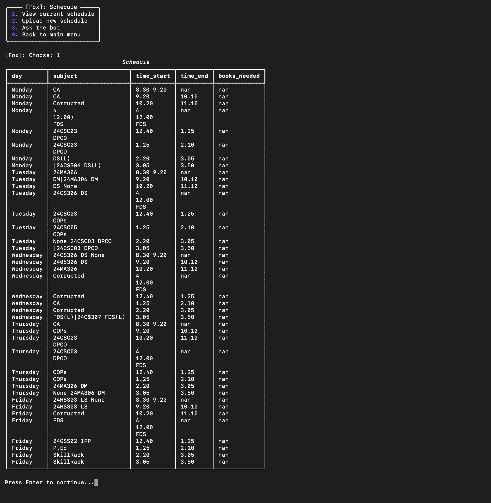
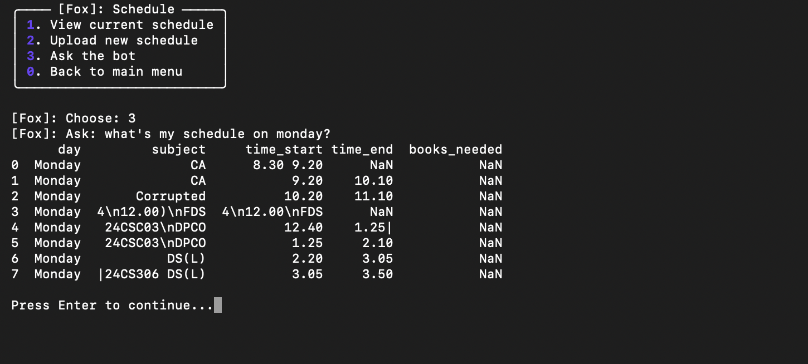
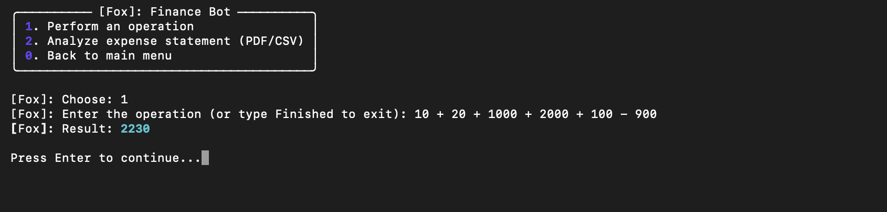
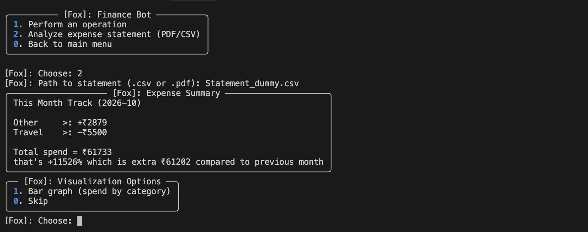
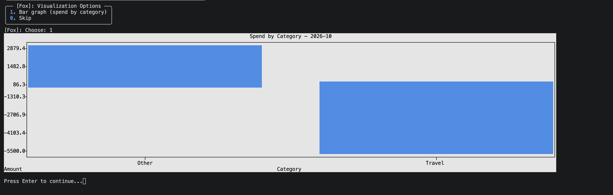
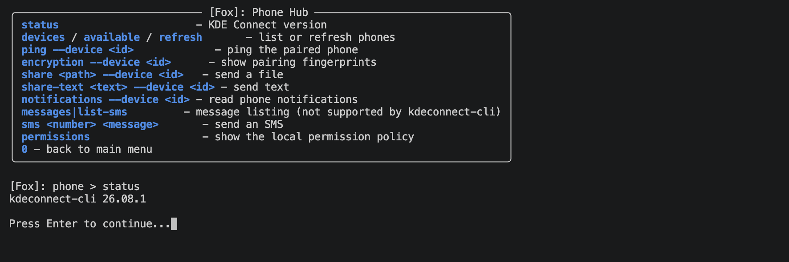
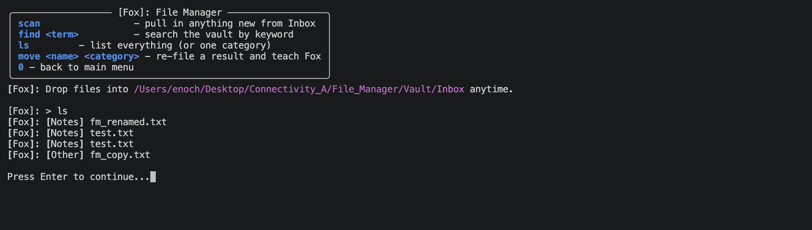
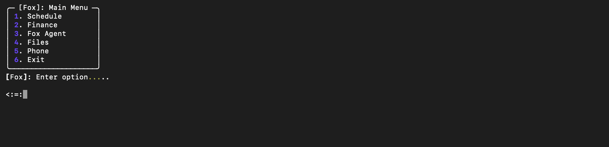

## **Mates-Helper**
I made this software to help me/ other to manage things like school/ college schedule, Finance management, Phone Integration in "CLI" userfriendly way..

## **Features:**
I have implemented some main features to this program..
    1.Schedule
    2.Files
    3.Phone
    4.Finance
    5.Fox Agent.

**Schedule:** This feature can help with your schedule turning "Image" -> "CSV" which can be used by Fox Agent Club members to help user regarding their schedult





**Finance:** This can help user with their finance, this tool provide graphs so user can see and manage their situvation..







**Phone:** This can help user to connect their Phone with thier pc (Fox Agent can't access this..) using "KDE Connect" so user can recieve message, notification in their pc



**File:** This is a dedicated space for Fox Agent, they can manage this file space, organise, search. I added a Trash feature so files can be recovered if agent deleted unintentionally.



**Fox Agent:** Fox Agent is a hybrid feature, Can be runned locally or in Cloud. We prefer local so we process personal data locally, and it has Fox Club members which can handle all the request of user.



## **Fox Club:**
The name itself states its a club, and in this club there are 4 major roles,
    1.Annie
    2.Julie
    3.Selina
    4.Gwen

Those AI have their specific roles so we can prevent most of the errors. 

The goal is to give the user the best response without "AI Hallucination Answer" or "Inaccurate Answer".

## **Club Member Roles:**
We have 4 special AI Characters,

1.Annie
2.Julie
3.Selina
4.Gwen

**Julie:** Julie handles user prompt, converts user prompt to breakable task which is later sent to rest of the AI to accomplish the task

**Annie:** Annie is like manager, She assigns the task to Selina and Gwem in their preffered format.

**Selina:** Selina is like the action player, She does the work which is assigned by Annie and gives it to security check (Which is Gwen)

**Gwen:** Gwen is Reviewer, Based on Annie assigned task, She performs the check of Selina work, If anything is wrong, Gwen reports to Brain/Orchestrator (Which is Python program i have made.) for further action

---

## Tools i used to build this..
- **Language:** Python 3.10+
- **CLI UI:** Rich, Plotext
- **Backend & APIs:** FastAPI, Uvicorn, WebSockets, FastMCP
- **Storage:** SQLite with WAL mode
- **Schedule OCR:** Pillow, Tesseract OCR, img2table, pdfplumber
- **Phone Integration:** KDE Connect via D-Bus
- **Local AI:** Ollama (qwen2.5 / llama), with fallback to Claude / Gemini / OpenRouter

---

## The Setup Process!

### 1. Getting Tools Ready..
- Python 3.10+
- (Optional for OCR) `tesseract-ocr` and `poppler-utils`
- (Optional for Phone) `kdeconnect-cli`

### 2. Installation
```bash
# Clone the repository
git clone https://github.com/Hcone-Eyne/Mates-Helper-.git
cd Mates-Helper-

# Set up virtual environment
python3 -m venv venv
source venv/bin/activate

# Install dependencies
pip install -r requirements.txt
```

### 3. Environment Setup
```bash
cp .env.example .env
```
*(Add your `FOX_API_TOKEN` and any optional API keys if you aren't using local Ollama).*

### 4. Run the Application
```bash
python main.py
```

### 5. Running Tests
Run the offline automated test suite:
```bash
pytest -q test/
```